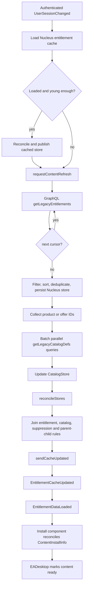

# EA Desktop authentication and library discovery

This document describes the authentication and owned-library pipeline in EA
Desktop build `13.809.0.6322`. It is based on IDALib/Hex-Rays output from the
installed binaries and a runtime trace captured on 2026-10-16. Addresses apply
only to this build.

The redacted control-flow trace is preserved in
`analysis/runtime/auth_library_2026-10-16.json` (`analysis/runtime/auth_library_2026-10-16.json`, local-only),
the controlled logout/credential-login trace is in
`analysis/runtime/interactive_relogin_2026-10-16.json` (`analysis/runtime/interactive_relogin_2026-10-16.json`, local-only),
and the endpoint-only inventory is in
`analysis/protocol/runtime_endpoints.json` (`analysis/protocol/runtime_endpoints.json`, local-only).

The most important correction to the earlier report is that
`/me/sdkEntitlements/entitlements` is not the normal desktop library feed. It is
an SDK/LSX-facing entitlement path. The main library is assembled by
`EABackgroundService.exe` from the GraphQL `getLegacyEntitlements` result,
catalog definitions, and the local install store.

## Component ownership

| Component | Responsibility in this pipeline |
|---|---|
| `EADesktop.exe` | Restores the sign-in cookie, runs the OAuth authorization-code/refresh flow, owns the user session and access token, retrieves persona/subscription state, consumes content-store updates, and gates external launch actions. |
| `EABackgroundService.exe` | Fetches the main entitlement list, hydrates catalog records, reconciles ownership and product metadata, maintains the persistent content caches, and publishes library updates over private IPC. |
| EA Desktop SPA | Renders the library from the native client's `EntitlementStore`, `CatalogStore`, and `InstallStore`; it is not the authoritative network client. |

## Authentication

### Observed remembered-login sequence

The 2026-10-16 trace shows this sequence:

```mermaid
sequenceDiagram
    participant Disk as Protected local state
    participant UI as LoginUIHandler / CEF
    participant Accounts as accounts.ea.com
    participant Identity as AccessTokenHandler
    participant FSM as DesktopFSM
    participant BGS as EABackgroundService

    Disk->>UI: restore remember-me cookie
    UI->>Identity: load cached persona and AccessTokenData
    Identity->>Identity: accept cached metadata; schedule short refresh
    UI->>Accounts: GET /connect/auth with restored cookie
    Accounts-->>UI: 302 carrying authorization result
    UI->>Accounts: POST /connect/token (authorization code)
    Accounts-->>Identity: access_token, expires_in, optional refresh/id token
    Identity->>Identity: validate token and user; schedule normal refresh
    Identity->>FSM: EventAuthenticationChanged
    FSM->>FSM: awaitingAuthentication -> authenticated
    Identity->>Accounts: getCurrentUser GraphQL query
    Identity-->>FSM: persona/subscription update
    FSM->>BGS: authenticated UserSessionChanged
```

The cached token is not what completed this remembered online login. The client
still performed an online authorization-code exchange. The restored `remid`
cookie allowed `/connect/auth` to finish without asking for credentials. Runtime
telemetry recorded `reme=valid`, `user_input=none`, and `token_format=JWS`.

### Observed logout and credential-login sequence

A controlled logout and login on 2026-10-16 established the path that the
remembered-login trace could not show:

```mermaid
sequenceDiagram
    participant UI as EADesktop UI / CEF
    participant Auth as LoginUIHandler / identity
    participant Disk as Protected local state
    participant Accounts as accounts.ea.com
    participant BGS as EABackgroundService

    UI->>Auth: ClientSignoutRequest / EventInitiateSignOut
    Auth->>Disk: delete remid and discard cookie jar
    Auth->>UI: clear client entitlement store
    Auth->>BGS: end UserSession; set auth token null
    Auth->>Disk: remove UIC/AI and UIC/PI
    Auth->>Auth: signingOut -> awaitingAuthentication
    Auth->>UI: uiLogin, flow FromLogout
    UI->>Accounts: load /connect/auth and collect credentials
    Accounts-->>UI: redirect to qrc login-success route
    UI->>Disk: persist new remember-me cookie
    Auth->>Accounts: POST /connect/token
    Accounts-->>Auth: JWS token response
    Auth->>Accounts: fetch persona/current-user state
    Auth->>BGS: start authenticated UserSession
    BGS-->>UI: publish cached library, then refreshed library
```

The logout deleted the `remid` cookies, discarded the CEF cookie state, cleared
the desktop entitlement cache, reset `AccessTokenHandler` to `Idle`, removed
both `UIC\AI` and `UIC\PI`, and caused BGS to set its authentication token to
null and unload entitlement data. The persistent BGS Nucleus/catalog files were
not deleted, which allowed the same account's cached library to be republished
after login; the BGS save/load code separately checks the current user identity.

The following login was explicitly labeled `FromLogout`, entered `uiLogin`, and
recorded `user_input=credentials`, `reme=none`, and an 85.7-second authorization
interval. Here `reme=none` means no remember-me credential was available when
the flow began. It does not mean the new login declined remember-me: the trace
shows a new `remid` being saved with an expiry about 60 days later.

After the UI reported authentication success, `/connect/token` completed in
1.74 seconds with a JWS token. The client scheduled its refresh for 173,662
seconds later (about 48.2 hours), fetched persona data in another 1.77 seconds,
then changed `awaitingAuthentication -> authenticated`. These timings are one
observation, not protocol constants.

### Authorization request

The observed production authorization endpoint is:

```text
GET https://accounts.ea.com/connect/auth
```

The request builder and trace establish these parameters:

| Parameter | Meaning/evidence |
|---|---|
| `client_id=JUNO_PC_CLIENT` | Desktop OAuth client identifier observed at runtime. |
| `sbiod_enabled=true` | EA accounts/login feature switch present in the interactive URL. |
| `response_type=code` | Authorization-code flow; present in the observed URL and supported by the static builder. |
| `code_challenge_method=S256` | PKCE method observed at runtime. |
| `code_challenge` | Per-request PKCE challenge. |
| `nonce` | Per-request anti-replay value. |
| `pc_sign` | EA-specific request signature/value. Its construction has not yet been fully recovered. |
| `redirect_uri=qrc:///html/login_successful.html` | Exact successful local completion route observed in the interactive request. |
| `display=junoClient/login` | Selects the desktop-client login presentation. |
| `locale=en_US` | Locale supplied by this observed client session. |

The CEF cookie jar restores the persistent `remid` cookie for `.ea.com` and the
`/connect` scope. The trace also shows an HTTP-only secure `sid` cookie during
the accounts flow. Cookie values are intentionally omitted.

`CookieJar::restoreRememberMeCookiesFromFile` at
`EADesktop.exe:0x1403C37A0` rejects a cookie when remember-me is disabled by
configuration, the stored expiration is missing or expired, the computer does
not match, credentials are invalid, or the cookie belongs to a different user.
The corresponding persistence path is `0x1403C2F30`.

### Token request

`AccessTokenRequestor` builds the token request at
`EADesktop.exe:0x1406FA9A0`:

```text
POST https://accounts.ea.com/connect/token
Content-Type: application/x-www-form-urlencoded
```

Common form fields are `client_id`, `client_secret`, and an optional token
format selector. The client secret comes from EA's client configuration; its
value is not recorded here.

For an authorization-code exchange the body contains:

```text
code=<authorization code>
grant_type=authorization_code
code_verifier=<PKCE verifier>       # when present
redirect_uri=<redirect URI>         # when present
```

For a refresh exchange the body contains:

```text
refresh_token=<refresh credential>
grant_type=refresh_token
refresh_tos=true                    # only for the TOS-refresh branch
```

The builder can also add `expires_in` and a test-only IP field. The numeric HTTP
method enum in the decompilation is corroborated as POST by the runtime trace.

The response parser at `EADesktop.exe:0x1406FB8E0`:

1. reads the `x-nexus-sequence` response header;
2. requires a nonempty `access_token`;
3. requires `expires_in`;
4. accepts optional `refresh_token` and `id_token`;
5. derives/checks the user ID represented by the returned token; and
6. rejects the response when required fields are absent or inconsistent.

`AccessTokenHandler::beginRefreshToken` at `0x1406CC900` refuses to enter the
refresh path without a refresh token. It labels normal refreshes
`AccessTokenRefresh` and the terms-of-service branch `TosAcceptance`, then runs
the configured retry policy. Cached-token loading is entered through
`0x1406D0250` and validated at `0x1406CDE10`. A valid cached record is marked as
the offline/cached source and schedules a short `CachedTokenRefresh`; it does
not prove that the token can be reused indefinitely online.

### Login variants and failure paths

`LoginUIHandler::login` (`0x1402F3430`) distinguishes initial, direct, and
external login requests. `directLogin` (`0x1402F1EC0`) attempts the accounts
authorization route without presenting the full credential UI when the cookie
state permits it. `uiLogin` (`0x1402F4290`) displays the sign-in UI when user
input is required. The request guard at `0x1406D58F0` rejects authentication
while offline and prevents duplicate, recursive, or single-use request reuse.

Authentication alone is not the final ready state. After the token is accepted,
the client retrieves the current user and waits for content readiness before it
accepts queued external actions.

### Current-user query

The authenticated `getCurrentUser` query at `EADesktop.exe:0x1406F20D0`
requests:

- `userId`, country, underage state, ban state, and ban end date;
- persona PSD, display name, name, namespace, and visibility;
- highest or most recent subscription level, status, end date, and type; and
- active Steam/Epic subscriptions with offer, duration, platform, status,
  status-reason, recurring, acquisition, start, and end fields.

It uses `Authorization: Bearer <access token>`. Persona and subscription data
are therefore separate from the owned-game entitlement query.

### Persistent authentication state

| Location | Established interpretation |
|---|---|
| `%LOCALAPPDATA%\Electronic Arts\EA Desktop\cookie.ini` | Opaque protected remember-me cookie container. It is binary/high-entropy despite the `.ini` extension. |
| `...\UIC\AI` | Encrypted/protected access-token cache. A runtime `DataDecryptError category=[AI]` is immediately followed by `AccessTokenHandler` cache-load failure; controlled logout explicitly removes category `AI`. |
| `...\UIC\PI` | Strongly associated with protected persona information. Controlled logout removes category `PI` alongside the persona reset, though the serializer type has not been recovered. |
| CEF `Network\Cookies` | Chromium cookie database containing cookie metadata, including `.ea.com` `remid`; values must be treated as credentials. |

The cache formats are protected and account/machine bound. They are unsuitable
as a stable API for another launcher.

## Main library discovery

### Startup and refresh state machine



The cache lifetime setting is
`app.contentStoreCacheMaxLifetimeSeconds`, default `2592000` seconds (30 days).
The observed stale-cache path reported an age of 4,863,455 seconds and selected
the `CacheTooOld` trigger. Other runtime-confirmed triggers are `UserLogin`,
`AutoRefresh`, `PendingLaunch`, and `SessionChangeRefresh`. The observed
automatic refresh was scheduled at 3,548 seconds, showing roughly hourly
refresh with jitter.

Startup is visibly two-phase when a usable cache exists. In the 15:48 login
trace, BGS started the first `Nucleus Query` and reconciled/published the cached
149-offer store in the same millisecond. The first network entitlement page
completed about 1.08 seconds later. This lets the UI become useful from cached
data while a fresh entitlement/catalog result is still being assembled; the
later result produces another store update.

The controlled credential login reproduced this behavior precisely. BGS
started `Nucleus Query`, reconciled, and sent the cached 149-offer store at
15:54:26.64. Its two entitlement pages completed at 15:54:27.74 and
15:54:28.77. Seven catalog batches then completed by 15:54:31.35, followed by a
second reconciled 149-offer update. Logout therefore clears the desktop's
in-memory view but does not erase the account-keyed BGS library cache.

`requestContentRefresh` at `EABackgroundService.exe:0x140374270` refuses an
online reload without an online-capable authenticated session. Cache-load
handling is at `0x140370670`; it also discards a result if logout occurred while
the asynchronous load was in flight.

### Entitlement request

`NucleusEntitlementStore::sendRequest` at
`EABackgroundService.exe:0x14038D210` sends the following operation to the
production service aggregation layer:

```text
POST https://service-aggregation-layer.juno.ea.com/graphql
Authorization: Bearer <access token>
```

```graphql
query getLegacyEntitlements(
  $limit: Int,
  $next: String,
  $storeFronts: [UserLegacyEntitlementStorefront!]!
) {
  me {
    legacyEntitlements(
      paging: {limit: $limit, next: $next},
      storefronts: $storeFronts,
      status: [ACTIVE, DISABLED]
    ) {
      next
      items {
        cdKey
        entitlementTag
        entitlementType
        externalType
        grantDate
        groupName
        id
        isSubscription
        isSubscriptionExpired
        lastModifiedDate
        originPermissions
        productId
        status
        statusReasonCode
        terminationDate
        trialTimeRemainingSeconds
        useCount
        version
      }
    }
  }
}
```

The normal storefront variable is `EA`, `EPIC`, and `STEAM`. The default page
size is 100 (`graphql.entitlementsQueryPageSize`) and is clamped to at least 1.
The `next` value from one response is copied into the following request. The
query timeout is configured to 60 seconds. `QueryRunner` identifies this work
as `Nucleus Query` and is configured for three attempts; the trace shows
attempt `[1/3]`.

The response callback at `0x14038BA10` accumulates page items. When `next` is
nonempty it calls `sendRequest` again. After the final page it filters invalid
records, sorts/deduplicates the collection, constructs a timestamped user
store, persists it, and wakes callers waiting for entitlement completion. The
2026-10-16 trace used two entitlement pages (2,724 and 1,730 response bytes).

The persistent-save path at `0x14038CBC0` refuses to save when no user is loaded
or when the store belongs to a user other than the current logged-in user.
Serialization enters `serializeNucleusStore` at `0x140C62F10` before the local
storage protection layer.

### Catalog hydration

Entitlements mostly identify products; they do not carry enough display,
install, or launch metadata. `EABackgroundService.exe:0x140381DB0` collects
offer IDs, splits them according to `graphql.catalogQueryPageSize`, limits
parallelism with `graphql.catalogQueryMaxParallelCount`, and sends
`getLegacyCatalogDefs($offerIds, $locale)`.

The returned legacy-offer fields are:

```text
offerId, contentId, basePlatform, primaryMasterTitleId, mdmProjectNumber,
achievementSetOverride, gameLauncherURL, gameLauncherURLClientID,
stagingKeyPath, mdmTitleIds, multiplayerId, executePathOverride,
installationDirectory, installCheckOverride, monitorPlay, displayName,
displayType, igoBrowserDefaultUrl, executeParameters, softwareLocales,
dipManifestRelativePath, metadataInstallLocation, distributionSubType,
downloads { igoApiEnabled, downloadType, version, executeElevated,
  buildReleaseVersion, buildLiveDate, buildMetaData, gameVersion,
  treatUpdatesAsMandatory, enableDifferentialUpdate },
locale, greyMarketControls, isDownloadable, isPreviewDownload,
downloadStartDate, releaseDate, useEndDate, subscriptionUnlockDate,
subscriptionUseEndDate, softwarePlatform, softwareId, downloadPackageType,
installerPath, processorArchitecture, macBundleID,
gameEditionTypeFacetKeyRankDesc, appliedCountryCode,
cloudSaveConfigurationOverride,
firstParties { partner, partnerId, partnerIdType }, suppressedOfferIds
```

The same operation requests game-product metadata:

```text
name, originOfferId, isAgeVerificationRequired,
baseItem { title, baseGameSlug, gameType,
  regionalRatingV2 { ageRating { minAge } } },
gameSlug
```

A Steam-App-ID variant is built at `0x140380F50`. The runtime login refresh
issued catalog batches in parallel, emitted catalog updates per batch, then ran
`reconcileStores` at `0x140372FB0`.

### Reconciliation and UI publication

Reconciliation performs more than a simple `productId == offerId` map. The
runtime and static paths show it:

1. builds an offer-ID-to-base-slug map;
2. applies suppressed-offer rules;
3. repairs base-game/DLC parent-child relationships;
4. joins entitlement status to the hydrated catalog entry;
5. publishes a cache update (149 offers in the observed profile); and
6. asks the install component to reconcile local install information for the
   resulting entitlements.

On the desktop side, `ClientCatalogCache::handleCatalogUpdated` at
`EADesktop.exe:0x14030FC50` creates or updates `CatalogStore` and emits
`CatalogStoreAdded`. `ClientContentCache::handleContentUpdated` at
`0x1403169F0` waits for user context, constructs the entitlement store, reports
sync success/failure, sends `EntitlementDataLoaded` with a cache identifier, and
emits `EntitlementCacheUpdated`. `GameData::handleEntitlementDataLoaded` then
initializes the SPA-facing content store from that cache identifier.

The desktop state machine can be authenticated while still rejecting an
external action because `isContentReady` is false. Runtime traces show
`EventEntitlementsLoaded` followed by a later successful
`EventReadyForExternalActions` check.

### Live ownership changes

The background service connects to:

```text
wss://service-aggregation-layer-subs.juno.ea.com/graphql-ws
```

Its `ownedGameProduct { ownedProductOfferId }` subscription is a coarse signal
that the owned library changed and needs refresh. Separately, EADesktop opens a
subscription containing detailed `entitlementChanged` fields (`id`, `status`,
`lastModifiedDate`, `groupName`, `entitlementTag`, `useCount`, source/type,
termination, version, product ID, and grant date). That detailed subscription
supports SDK/local-service and play-time behavior; it is not the initial main
library download.

### Local content caches

Current protected files under `C:\ProgramData\EA Desktop` include `NS`,
`CATS2`, and `IS`. Their names, sizes, write times, and nearby code strongly
indicate Nucleus-entitlement, catalog, and install stores respectively. `NS`
and `CATS2` were rewritten during the observed pending-launch refresh. The
exact filename-to-store mapping remains an inference until the local-storage
category argument is recovered at its call site, so a launcher should not treat
these filenames as a stable public contract. The contents are high-entropy and
pass through EA's local storage layer.

## What this means for a custom launcher

The project target is now a standalone launcher with no EA Desktop process.
The former silent-broker prototype remains useful only as a behavioral oracle
while each account, content, license, cloud-save, and launch subsystem is
replaced.

The login and primary owned-library protocols are implemented and live-validated:

1. generate the EA `pc_sign` payload/signature locally and create an S256 PKCE
   pair;
2. host the account page in a WebView and intercept the
   `qrc:///html/login_successful.html` authorization-code redirect;
3. exchange the code at `/connect/token`, protect the refresh token locally,
   and load current user/persona state;
4. page through `getLegacyEntitlements` and hydrate offer/product records with
   `getLegacyCatalogDefs`; and
5. join those remote records with an independent install store.

An all-owned-games view cannot be implemented reliably from the SDK
`sdkEntitlements` request. A direct implementation needs all of the following:

- an authorized OAuth client compatible with the `JUNO_PC_CLIENT` accounts
  flow, including the EA-specific authorization signing behavior;
- token refresh and user/persona handling;
- paginated `getLegacyEntitlements` access;
- batched `getLegacyCatalogDefs` hydration;
- suppression, DLC-parent, subscription, release/trial, and install-store
  reconciliation; and
- live subscription handling or periodic refresh.

The implementation does not copy EA Desktop cookies or token caches. It
recreates the protocol and extracts version-pinned build credentials through a
private DPAPI boundary. On 2026-10-17 it completed interactive login, refreshed
the token, executed `getCurrentUser`, retrieved 40 entitlement records, and
hydrated 34 catalog offers plus 33 product records without calling EA Desktop.
The complete response is DPAPI-protected at `private/ea_library.dpapi`; the
sanitized evidence is
`analysis/runtime/standalone_library_2026-10-17.json`. The detailed request and
`pc_sign` analysis is in [STANDALONE_AUTH_RE.md](STANDALONE_AUTH_RE.md).

The 40 values above are raw entitlement records, not the final visible-game
count. EA's reconciliation layer still applies suppression, base-game/DLC,
subscription, release/trial, and local-install rules. The older runtime trace's
149-offer reconciled store therefore cannot be compared directly with this raw
entitlement count.

## Static evidence map

| Behavior | Address | Artifact |
|---|---|---|
| Remember-me restore/persist | `EADesktop.exe:0x1403C37A0`, `0x1403C2F30` | `analysis/decomp/EADesktop-auth.json` |
| Login/direct/UI dispatch | `EADesktop.exe:0x1402F3430`, `0x1402F1EC0`, `0x1402F4290` | `analysis/decomp/EADesktop-auth-deep.json` |
| Token request construction | `EADesktop.exe:0x1406FA9A0` | `analysis/decomp/EADesktop-token-request-builder.json` |
| Token response parsing | `EADesktop.exe:0x1406FB8E0` | `analysis/decomp/EADesktop-auth.json` |
| Refresh/cache orchestration | `EADesktop.exe:0x1406CC900`, `0x1406CDE10`, `0x1406D0250` | `analysis/decomp/EADesktop-auth-flow-addresses.json` |
| Current user | `EADesktop.exe:0x1406F20D0` | `analysis/decomp/EADesktop-library.json` |
| Entitlement request | `EABackgroundService.exe:0x14038D210` | `analysis/decomp/EABackgroundService-auth-library-deep.json` |
| Entitlement page callback/save | `EABackgroundService.exe:0x14038BA10`, `0x14038CBC0` | `analysis/decomp/EABackgroundService-nucleus-cache.json` |
| Cache-age decision | `EABackgroundService.exe:0x140370670` | `analysis/decomp/EABackgroundService-nucleus-cache.json` |
| Catalog hydration | `EABackgroundService.exe:0x140381DB0`, `0x140380F50` | `analysis/decomp/EABackgroundService-auth-library-deep.json` |
| Store reconciliation | `EABackgroundService.exe:0x140372FB0` | `analysis/decomp/EABackgroundService-auth-library-deep.json` |
| Desktop cache consumption | `EADesktop.exe:0x1403169F0`, `0x14030FC50` | `analysis/decomp/EADesktop-library.json` |
| Detailed entitlement subscription | `EADesktop.exe:0x14051B960`, `0x140510A90` | `analysis/decomp/EADesktop-library.json` |

The timeline can be regenerated without copying credentials by running
`tools/extract_auth_library_timeline.py` against the EA Desktop and background
service logs.

