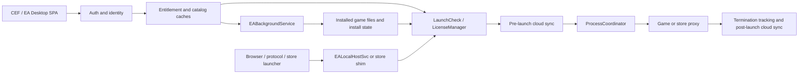

# EA Desktop 13.809.0.6322: architecture and end-to-end behavior

For the current implementation status, recent Battle for Neighborville launch
tests, remaining EA Desktop dependency, and next investigation, see
[PROGRESS_REPORT_2026-10-20.md](PROGRESS_REPORT_2026-10-20.md).

For the custom-launcher implementation boundary, exact URI grammar, private IPC
schemas, LSX authentication, state machines, and the working prototype, see
[CUSTOM_LAUNCHER_SPEC.md](CUSTOM_LAUNCHER_SPEC.md). The address-to-claim map is
in analysis/EVIDENCE_INDEX.md (`analysis/EVIDENCE_INDEX.md`, local-only). The exact boundary
for launching with no `EADesktop.exe` process is documented in
[STANDALONE_GAP_ANALYSIS.md](STANDALONE_GAP_ANALYSIS.md).
The detailed OAuth and main-library reconstruction is in
[AUTH_LIBRARY_RE.md](AUTH_LIBRARY_RE.md).
The standalone login verdict, `pc_sign` field map, request forms, implementation
status, and remaining byte-exact inputs are in
[STANDALONE_AUTH_RE.md](STANDALONE_AUTH_RE.md).
The legacy OOA license protocol, failed mode-4 binding test, and successful
independent renewal for MOHPA are in
[LICENSE_ACTIVATION_RE.md](LICENSE_ACTIVATION_RE.md).

## Scope and evidence

This report covers the installed EA Desktop build `13.809.0-6322-ebe13ce01`
captured on 2026-10-16 from:

`C:\Program Files\Electronic Arts\EA Desktop\EA Desktop`

The principal executables have valid Electronic Arts signatures. Exact paths,
sizes, versions, SHA-256 hashes, and signature results are recorded in
the artifact manifest (`artifacts/manifest.json`, local-only). The analysis used IDA Pro 9.1
through idalib. Its repeatable scripts are under [tools](../../tools), compact string
and cross-reference inventories are under analysis/index (`analysis/index`, local-only), and
focused Hex-Rays output is under analysis/decomp (`analysis/decomp`, local-only).

Runtime observations come from the application's existing local logs. The
extractor copies only targeted records, removes credential-like values, and
records each source hash in analysis/runtime/logs.json (`analysis/runtime/logs.json`, local-only).
These logs span multiple dates and may include earlier EA Desktop builds, so
they corroborate flows rather than prove that every historical result belongs
to build 13.809.

Evidence labels used below:

- **Confirmed static**: visible in the captured build's strings, control flow,
  imports, or decompiled code.
- **Observed runtime**: present in the sanitized historical log snapshot.
- **Inference**: the best explanation of confirmed evidence, with its limit
  stated explicitly.

## Component map

| Component | Main responsibility established by the analysis |
|---|---|
| `EADesktop.exe` | CEF/SPA user interface, authentication, consumption of entitlement/catalog cache updates, launch checks, licensing, cloud saves, and process coordination. |
| `EABackgroundService.exe` | Main owned-library and catalog retrieval plus privileged content operations: install validation, download planning, manifests, differential patching, integrity checks, installer execution, and persistent content/install stores. |
| `EALocalHostSvc.exe` | Authenticated local HTTP/IPC bridge for web/protocol-originated launch requests. |
| `EALauncher.exe` / `EALaunchHelper.exe` | EA Desktop bootstrap, update-aware startup, pending run-to-play state, and starting the desktop client in the interactive user's session. |
| `GetGameToken.exe` | Small helper used during Denuvo reactivation to read/return the game token. It has shared-memory/file-mapping primitives and no independent network stack. |
| `EASteamProxy.exe` / `EASteamLauncher.exe` | Steam API, Steam App ID, overlay, locale, ownership/launch handoff, and EA local-launch messaging. |
| `EAEgsProxy.exe` / `EAEgsLauncher.exe` | Epic Online Services credentials, EOS Connect login, and Epic-to-EA launch handoff. |
| `Link2EA.exe` | Authenticated account-link/launch request orchestration, especially for Steam-linked launches. |

The overall dependency chain is:



## 1. Login and session establishment

### Confirmed static flow

1. `LoginUIHandler` accepts an initial, direct, or external login request. With
   a valid restored remember-me cookie it can complete a direct login without
   credential input; otherwise it opens the EA sign-in UI in an embedded CEF
   view. A successful navigation can reach
   `qrc:///html/login_successful.html`; logout uses `/connect/logout`.
2. The client restores its remember-me cookie through
   `CookieJar::restoreRememberMeCookiesFromFile`. It can persist the updated
   remember-me cookie after authentication. The exact file format and at-rest
   protection were not established in this pass.
3. The identity layer loads cached access-token metadata when possible. In the
   observed remembered login, it still made a fresh authorization-code request
   to `https://accounts.ea.com/connect/auth`, followed by a form POST to
   `https://accounts.ea.com/connect/token`. The focused decompilation at
   `EADesktop.exe:0x1406FB8E0` parses a successful HTTP 200 JSON response and
   requires `access_token` and `expires_in`; it optionally accepts
   `refresh_token` and `id_token`. Missing or inconsistent token/user fields
   reject the response. It also reads the `x-nexus-sequence` response header.
4. Successful identity authentication is followed by persona loading. Only
   after that does the application move into its authenticated state and start
   account-scoped data synchronization.
5. Downstream authenticated requests use an `Authorization: Bearer <access
   token>` header. Refresh logic is present, so an expired access token does not
   require another visible password login when refresh/remember-me state remains
   usable.

The production endpoints were confirmed at runtime. The authorization request
uses the `JUNO_PC_CLIENT` client ID, authorization-code response type, and S256
PKCE, plus nonce and EA-specific `pc_sign` parameters. The token request builder
at `0x1406FA9A0` selects either `grant_type=authorization_code` with optional
`code_verifier`/`redirect_uri`, or `grant_type=refresh_token` with an optional
`refresh_tos=true`.

Relevant static evidence and the complete request field map are in
[AUTH_LIBRARY_RE.md](AUTH_LIBRARY_RE.md). Focused decompilation is in
EADesktop-auth.json (`analysis/decomp/EADesktop-auth.json`, local-only), especially functions
`0x1403C37A0` (remember-me cookie handling), `0x1406FB8E0` (token-response
parsing), `0x1406CC900` (refresh path), `0x1406CDE10` (loaded-token handling),
and `0x1406D0250` (cached token data).

### Observed runtime sequence

The sanitized logs show an initial login restoring the remember-me cookie,
loading the login page successfully, requesting an access token, accepting a JWS
access token, moving from `awaitingAuthentication` to `authenticated`, and then
updating persona data. This matches the static state machine. See the `auth`
category in logs.json (`analysis/runtime/logs.json`, local-only).

A controlled logout/relogin further confirmed that logout deletes `remid`,
clears the desktop entitlement cache, removes protected `UIC\AI` and `UIC\PI`,
resets the token handler, and makes BGS unload the user session. The subsequent
`FromLogout` UI flow loaded the full authorization URL, accepted credentials,
saved a new remember-me cookie, exchanged the code at `/connect/token`, fetched
persona data, and rebuilt the library. The redacted trace is in
interactive_relogin_2026-10-16.json (`analysis/runtime/interactive_relogin_2026-10-16.json`, local-only).

## 2. Library, ownership, and game metadata

EA Desktop separates ownership from product metadata:

- **Entitlements** answer what the account owns or may use. Returned fields
  include entitlement ID/tag/type, product ID, grant and termination dates,
  group name, use count, source, status, and version.
- **Catalog definitions** describe the product and how the PC client handles it.
  Returned fields include offer/content/software/master-title IDs, display name,
  slug, game type and rating, base platform, executable and arguments, install
  directory/check, supported locales, package/installer type, release and
  subscription dates, downloadability, build/version metadata, staging key,
  `dipManifestRelativePath`, first-party associations, and suppressed offers.
- **Install state** is supplied by the background service and maps software IDs
  to installed/not-installed/update state and local paths.

The main owned-library request is the paginated GraphQL operation
`getLegacyEntitlements`, issued by `EABackgroundService.exe` for the `EA`,
`EPIC`, and `STEAM` storefronts with `ACTIVE` and `DISABLED` status. The service
then batches the returned product/offer IDs through `getLegacyCatalogDefs` and
reconciles the result with the install store. `sdkEntitlements` is a separate
SDK/LSX-facing path and is not the normal desktop library feed. The SPA consumes
the resulting local `EntitlementStore`, `CatalogStore`, and `InstallStore`; it
does not itself act as the authoritative library network client.

The catalog query is also the bridge into installation and launching. Its data
contains the executable, launch arguments, installer path, package type,
manifest path, differential-update capability, and external launcher metadata.
Thus a library tile is assembled by joining an account entitlement to catalog
data and then to the machine's install record.

The exact query, pagination, catalog schema, refresh triggers, and reconciliation
sequence are in [AUTH_LIBRARY_RE.md](AUTH_LIBRARY_RE.md). Desktop-side anchors
are in EADesktop-library.json (`analysis/decomp/EADesktop-library.json`, local-only):
`0x1403169F0` initializes content/UI state, `0x14030FC50` updates the catalog
cache, and `0x14051B960` handles entitlement subscription data. The complete
query strings and their xrefs are preserved in
EADesktop.json (`analysis/index/EADesktop.json`, local-only).

The runtime snapshot shows this ordering after authentication: content-cache
sync, `EntitlementDataLoaded`, SPA `ContentStore` initialization,
`EventEntitlementsLoaded`, and catalog-cache synchronization. The `library`
category in logs.json (`analysis/runtime/logs.json`, local-only) preserves those records.

## 3. Download and installation

The desktop client sends install/content requests over its internal IPC layer to
`EABackgroundService.exe`. The service rejects a request unless its entitlement
store is loaded and the content is internally installable; it also checks the
software ID, DLC parent relationship, destination device/path, and required
catalog/install metadata. Content modification additionally requires suitable
network/auth state and a connected client, unless the service is continuing an
already-authorized operation.

The confirmed install pipeline is:

1. **Resolve the payload.** The service submits a GraphQL `downloadUrl` request
   containing `offerId` and optional CDN/build/language/patch-from-version
   values. The response can contain the full archive URL and size, sync-package
   URL, and a known-version update plan with base and language streams.
2. **Acquire metadata.** The state machine advances through `GetDownloadUrl`,
   `GetContentManifest`, and `LoadInstallManifest`. DiP packages use
   `__Installer\installerdata.xml` plus catalog fields such as
   `dipManifestRelativePath` and `installerPath`.
3. **Plan full or differential work.** The service supports a full-package path
   and KVP/KPP/KPS differential updates. It downloads patch-plan and stream
   metadata, verifies the KPP checksum, evaluates free disk space and feature
   support, and chooses normal or in-place patching. The journal makes an
   interrupted session resumable.
4. **Stage and transfer.** It preallocates output files, schedules local-copy and
   remote-download chunks, tracks the download session, and cleans temporary
   files on completion/cancel. Pause and cancellation are first-class states.
5. **Verify.** Downloaded content receives CRC32/integrity checking; patch-plan
   metadata has its own checksum validation. The service also sanitizes file
   paths and permissions before materializing package content.
6. **Finalize.** The flow reaches `RunTouchup`, launches the package's
   installer/touchup program, waits for and maps its exit code, handles declared
   dependencies, and writes the resulting installation state back to the
   install store. The desktop client then receives the updated status over IPC.

Focused evidence is in
EABackgroundService-download-install.json (`analysis/decomp/EABackgroundService-download-install.json`, local-only):
`0x140299D60` prepares a job, `0x1402B18F0` verifies install requests,
`0x140282A70` assembles flow parameters, `0x14032B670` retrieves content
manifests, `0x140405720` resolves the DiP manifest, `0x14041B880` maps install
states, `0x1403449E0` performs CRC/checksum work, and `0x14031F500` handles the
touchup process result.

The historical EA logs contain install-store reconstruction and an activation
triggered by a content-install state change; they do not contain a clean passive
start-to-finish payload trace. A later controlled standalone run did complete a
roughly 3.46 GB MOHPA archive extraction and signed touchup, so the implemented
full-package path has runtime validation even though EA Desktop's own transfer
scheduler was not passively captured end to end.

## 4. Activation and licenses

EA Desktop manages license acquisition and renewal. A legacy protected title's
own Activation runtime can validate and use an already cached signed license
without EA Desktop once its local run-to-play check succeeds.

1. `LaunchCheckComponent` decides whether a license request is needed. It skips
   content that is externally managed, not playable, unreleased, an expired
   trial, missing an executable, or already covered by a valid license/no-license
   rule.
2. `LicenseManager::requestLicense` first reads cached license data. A valid
   license returns immediately. A missing, invalid, undecryptable, or stale
   license causes a new request using account authorization, after which the
   manager reads the license again.
3. Protected titles can take the Denuvo reactivation path.
   `reactivateDenuvoLicense` invokes `GetGameToken.exe`, waits up to 30 seconds,
   checks its exit code, and reads the returned token. The helper's tiny size,
   file-mapping/mutex imports, and absence of networking support indicate that
   it retrieves a token exposed by the protected title/runtime and hands it back
   to EA Desktop; the network license request remains in `LicenseManager`.
4. The resulting license is available before the game process is released into
   the normal launch path. Error mappings distinguish missing game tokens,
   Denuvo-token failure, invalid protection, decryption failure, legacy-license
   failure, and reactivation failure.

Static evidence is in
EADesktop-activation.json (`analysis/decomp/EADesktop-activation.json`, local-only):
`0x140797AF0` and `0x140799370` implement the license request/readback flow,
`0x14079FC70` reactivates Denuvo, `0x14079E040` runs the game-token helper, and
`0x1407897C0` joins licensing to launch.
GetGameToken.json (`analysis/index/GetGameToken.json`, local-only) documents the helper's
small import/string surface.

Focused MOHPA analysis adds the local handoff details. `mohpa.exe` is an OOA
wrapper importing `Activation.dll` ordinal 100. The DLL creates an inheritable
4 KB shared mapping, writes the wrapped executable path, PID, content IDs,
`RequireOrigin`, action, and failure fields, then starts
`ActivationUI.exe /SMOID=<decimal handle>`. ActivationUI validates the cached
license and reports the action through this block.

The run-to-play value is separate from `SMOID`. `ActivationUI.exe:0x405E10`
reads `EARtPLaunchCode`, parses it as a decimal integer, and compares it with
locally generated values for UTC yesterday through three days ahead. The exact
unsigned 32-bit algorithm is:

```text
x = (104729*year) XOR (350377*day) XOR (224737*month)
code = x XOR (x << 16) XOR (x >> 16)
```

The identical generator is present in current
`EADesktop.exe:0x1404DACA0`, where the resulting decimal string is placed in
launch environment data. A correct value makes ActivationUI continue locally;
failure enters its `origin2://game/launch/...` EA-client fallback.

`GetGameToken.exe` serves a different path. It opens an inherited 4 KB mapping
from its decimal command line, dynamically loads `dbdata.dll`, calls exported
`getTableData`, and writes `GameToken` to the block. EA Desktop's caller waits
up to 30 seconds and uses the result during license request/reactivation. No
persistent `dbdata.dll` was found in the current game or EA directories, so its
provisioning remains unresolved.

Historical runtime records independently show both forms: a license requested
after a Battlefield V content-state change, and title-launch requests where the
cached license was absent/stale, Denuvo reactivation ran, and the new license was
successfully read. A later Titanfall 2 Steam launch also fetched a new license.
The production legacy OOA URL has since been resolved to
`https://gateway.ea.com/proxy/access/licenses`. Its signed response and local
validation are documented in [LICENSE_ACTIVATION_RE.md](LICENSE_ACTIVATION_RE.md).
No credential or license blob was retained in the analysis artifacts.

## 5. Launching an installed game

### Direct EA-managed launch

1. A UI, SDK, browser/protocol, or run-to-play request identifies content by
   offer ID, content ID, master-title ID, or slug.
2. `ClientLauncher::requestLicenseAndLaunch` resolves the joined entitlement,
   catalog, and install records; checks playability, release/trial state,
   executable presence, and concurrent-process restrictions; and obtains the
   required access token/license.
3. `ProcessCoordinator` receives the resolved executable, working directory,
   arguments, locale, trial/elevation flags, and request source.
4. It performs pre-launch cloud-save synchronization and then creates the game
   process (or the catalog-selected anti-cheat/launcher executable). It monitors
   the process and broadcasts progress/state.
5. On termination it records the exit code/session duration and performs
   post-game cloud synchronization.

The principal static anchors are
EADesktop-launch.json (`analysis/decomp/EADesktop-launch.json`, local-only):
`0x1407897C0` handles request-license-and-launch, `0x1405F3710` performs the
license-auth portion, and the `0x1405Fxxxx` group implements
`ProcessCoordinator`, including cloud sync and process startup.

The runtime snapshot shows this exact sequence for Battlefield V: resolved
working directory and offer/content IDs, a license preload, launch through
`EAAntiCheat.GameServiceLauncher.exe` or `bfv.exe` depending on the request,
pre-launch cloud sync, process termination/exit-code handling, and post-launch
cloud sync. Some historical attempts exited quickly; those results describe the
recorded machine/session, not the general launch architecture.

### EA-independent license acquisition and launch

`standalone_launcher/launch.py` resolves launchers from the installed
`__Installer/installerdata.xml`, prefers a non-setup entry, computes the RTP
value from the current UTC date, and creates the executable directly. It does
not invoke `origin2`, EA IPC, EALauncher, or the background service.

The controlled 2026-10-19 MOHPA test stopped `EADesktop.exe`,
`EALaunchHelper.exe`, `EALauncher.exe`, and `EABackgroundService`, then started
manifest launcher UID `2-2` (`mohpa.exe`) with only `EARtPLaunchCode` added to
the inherited environment. The protected wrapper accepted the existing signed
license and reached `mohpa_setup.exe`; no EA client process appeared during the
12-second observation. This proves client-independent cached-license launch for
this title. A second run supplied the title-native `nolauncher` argument and
reached a `mohpa.exe` window titled `Medal of Honor Pacific Assault(tm)` while
the same EA components remained stopped. The old full-screen window still
reported `Responding=false` after 30 seconds, so this establishes direct process
and window creation but not successful gameplay input. A later test acquired a
fresh, EA-signed license through the standalone OAuth session using the title's
confirmed legacy machine binding. The game process remained alive and the new
license persisted, with EA processes still absent. This does not establish
Denuvo, EA AntiCheat, Steam, or Epic compatibility.

### Browser and local-protocol launch

`EALocalHostSvc.exe` exposes the local bridge. Its request handler validates the
connection, creates a `LocalHostGameLaunchRequest`, broadcasts it over EA's
internal messaging layer, waits for `LocalHostGameLaunchResponse`, and returns
the result. Invalid callers receive `{"error":"NOT_AUTHORIZED"}`. Evidence is
in EALocalHostSvc-routing.json (`analysis/decomp/EALocalHostSvc-routing.json`, local-only),
notably `0x140055570` (request processing), `0x140054B00` (response handling),
and `0x1401C8810` (connection validation).

`EALaunchHelper.exe` handles update-aware startup and pending run-to-play state.
It can start EA Desktop with arguments such as
`-updater_call -ls=LaunchHelper -silent -gameSdkPort=3216`; when launched from a
service context it obtains the interactive user's token before process creation.
See EALaunchHelper-launch.json (`analysis/decomp/EALaunchHelper-launch.json`, local-only),
especially `0x14010E0C0` (start executable), `0x1401C04C0` (interactive-user
token path), and the update state logic around `0x14008C100`.

### Steam and Epic launch

Steam launches use the EA Steam proxy/launcher pair and a `steam2ea` handoff.
The proxy contains Steam API interface versions, `SteamAppId`, overlay callbacks,
`IGO64.dll`, locale/purchase messages, and EA `LocalHostGameLaunchRequest` /
response types. The runtime snapshot shows a Titanfall 2 Steam launch resolving
to `EASteamProxy.exe`, followed by the normal EA license path. See
EASteamProxy.json (`analysis/index/EASteamProxy.json`, local-only) and
EASteamLauncher.json (`analysis/index/EASteamLauncher.json`, local-only).

Epic launches use EOS. `EAEgsLauncher.exe` and `EAEgsProxy.exe` embed a
`getEpicCredentials` GraphQL query keyed by EA offer ID. It returns EOS
`productId`, `sandboxId`, `deploymentId`, credential ID, and credential secret;
the launcher then performs EOS Connect login, creates a user when required, and
reports the launch result through the same EA messaging types. This describes
the fields and control flow only; no credential value was extracted. See
EAEgsLauncher.json (`analysis/index/EAEgsLauncher.json`, local-only) and
EAEgsProxy.json (`analysis/index/EAEgsProxy.json`, local-only).

`Link2EA.exe` contains `processLink2EARequests` and an authenticated
`Link2EARequest` state machine with start, update, timeout, request, telemetry,
and reply/finish phases. It shares the EA local game-launch request/response
messages and Steam App ID metadata. See
Link2EA.json (`analysis/index/Link2EA.json`, local-only).

## What is established and what remains open

The evidence establishes the responsibility boundaries and complete logical
chain:

`remember-me/interactive login -> access and refresh tokens -> persona ->
entitlements + catalog + install state -> download URL and manifests -> verified
install/touchup -> cached or renewed license -> optional Denuvo token/reactivation
-> pre-launch cloud sync -> direct/store-proxy process -> termination tracking ->
post-launch cloud sync`.

The following details still require targeted analysis or runtime validation:

- first activation and independent machine-binding derivation for other
  legacy OOA titles;
- `dbdata.dll` provisioning and Denuvo reactivation on a title that needs it;
- update, repair, dependency, resume, and uninstall behavior across more DiP
  package variants;
- manual gameplay-input validation for MOHPA and a second direct EA title;
- standalone EA AntiCheat, Steam, and Epic launch paths;
- cloud-save lock, conflict, transfer, and post-game synchronization behavior.

Further runtime records should continue retaining only process/file/IPC
metadata and redacted HTTP structure. Cookie values, bearer tokens, account
identifiers, license blobs, game tokens, EOS secrets, and signed URL query
parameters remain excluded.
